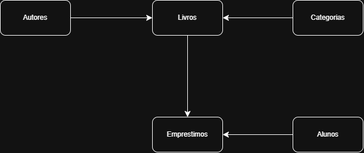

# Projeto 02 - Sistema de Biblioteca

Projeto de banco de dados feito em SQL Server para controlar os livros, autores, alunos e empréstimos de uma biblioteca escolar fictícia.

## Objetivo

Criar um banco de dados que responda perguntas do dia a dia da biblioteca:
- Quais livros estão emprestados agora?
- Quais empréstimos estão atrasados?
- Quais livros nunca foram emprestados?
- Qual aluno mais pegou livros?

## Tecnologias

- SQL Server
- SQL Server Management Studio (SSMS)
- draw.io (diagrama)
- Git e GitHub

## Diagrama

## Tabelas

- autores
- categorias
- livros
- alunos
- emprestimos

## Conceitos usados

- Chave primária e chave estrangeira
- IDENTITY (numeração automática)
- JOIN e LEFT JOIN
- GROUP BY e COUNT
- DATEDIFF e GETDATE (cálculo de dias de atraso)
- Valores NULL (livro ainda não devolvido)

## Como executar

1. Abra o SQL Server Management Studio
2. Abra o arquivo BIBLIOTECA.sql
3. Execute o script inteiro
4. O banco biblioteca será criado com as tabelas, os dados e as consultas

## Autor

Jhoni - estudante de Análise e Desenvolvimento de Sistemas